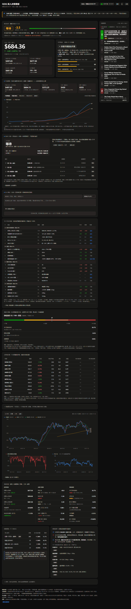

# QQQ / 七姐妹 / 比特币 买入决策看板



**一个不用装、不用登录、双击就能开的单文件网页。** 它把 19 个常用美股择时指标（趋势、估值、情绪、宏观四组加权）压成一个每日信号：强烈买入 / 买入 / 等待 / 卖出 / 强烈卖出，并把「为什么是这个结论」逐项摊开给你看。

- **9 个标的随时切**：右上角下拉框选 QQQ / NVDA / MSFT / AAPL / GOOGL / AMZN / META / TSLA / **BTC**，图、价格卡、年线、四档方案、指标明细、回测全都跟着换到这只标的上。
- **比特币是另一套指标体系**：美股那 19 项（PE / CAPE / ERP / 成分股宽度）对比特币没有意义，比特币页面换成 **周期 / 链上估值 / 情绪与资金 / 宏观流动性** 四组 19 项，权重和阈值都按比特币自己的历史重新标定，见下面「比特币页面」。
- **达人观点随手记**：听到谁怎么说，直接在「达人观点」卡里记下来（署名、日期可选），按标的各存一份、列表呈现，和看板结论并排看。
- **今日动作一眼看完**：现价、距目标价、时间闸门、风险清单触发情况，不用自己算。
- **数据能自动就自动**：16 项由行情、成分股和公开数据源现算（CAPE、巴菲特指标、F&G、AAII、Put/Call、HY OAS、SOFR−IORB 等），只剩 3 项需要手填；抓不到的项自动退回手填值，不会报错或卡住。
- **离线也能用**：日 K 快照内嵌，断网打开照样有图有结论，只是行情停在快照那天。
- **不装神弄鬼**：权重和分档是主观的、写在 README 里；每个指标名悬停都有一句话解释；信号只是把多个视角摆在一起，不是被验证过的模型，更不是投资建议。

双击 `index.html` 就能用。不用装东西，不用起服务器，不需要 API key。

`index.html` 是**真的单文件**：没有一个 `<script src>`、`<link href>`、CDN 或 `@import`，日 K 快照直接内嵌，
断网也是完整可用（只是行情停在快照那天）。Safari 双击也能开，要最稳就双击 `serve-dashboard.bat` 用 http 打开。

---

## 切换标的：QQQ + 科技七姐妹

右上角的下拉框切标的，**选哪个，全部模块就都指向哪个**：

| 模块 | 切换后变成什么 |
|---|---|
| 价格卡 / 年线卡 | 这只股票的现价、涨跌、年线 MA5、MA5、MA200、52 周区间 |
| 主图 / 回撤图 / RSI 图 | 这只股票自己的日 K 和指标 |
| MA5 方案 | 这只标的**自己的**四档价格与时间闸门（各自存各自的，互不影响） |
| 19 指标 | 与个股相关的项（价格 vs 年线、回撤、RSI、MACD、均线排列、PE）换成该股读数；市场类指标（CAPE、F&G、HY OAS、加息路径等）本来就是全市场的，保持不变 |
| 成分股 / 同组 | 选 QQQ 看十大权重股；选个股看「七姊妹 + QQQ 同组对比」，当前标的高亮 |
| MA5 回测 | 用这只股票自己的日线重跑 |
| 市场资讯 | 仍是 QQQ / 纳指 / 七姊妹的共用资讯池（个股单独的消息源没有免费且免翻墙的）；切到比特币时换成「比特币 / 加密 / 流动性」词表 |

- 默认方案：QQQ 沿用 **488 / 400 / 380 / 300**；个股的第 1 批 = **自己的年线 MA5**（四舍五入），往下按同样比例（约 −18% / −22% / −39%）自动给出，第一次打开时可以改，改完按标的分别记住。
- **个股的警示**：指数有长期向上的底，个股会真的跌到零。四档口径只回答「什么时候买第一笔」，不回答「这家公司还行不行」——买之前先看基本面有没有坏，看图顶部的黄色提示条。
- 上次看的标的会记住；也可以用 `index.html?t=NVDA` 直接打开某一只（可和 `?theme=light` 串联）。

### 达人观点（记录 + 呈现）

「MA5 方案」下面有一张 **达人观点** 卡：

- 写一句就存（署名、日期可选；日期默认今天），**Ctrl/⌘+Enter** 也能直接保存；
- 每条显示「观点正文 + 署名 + 日期」，按日期倒序，点右边的 **×** 删除；
- **按标的各存各的**：记在 NVDA 上的不会出现在 TSLA 上，切标的自动换；
- 存在浏览器 localStorage（`qqq-dash-settings` 的 `notes` 字段，每只最多 60 条），不上传任何地方；
- 它只是「记录和并排呈现」，不参与 19 个指标的评分——别把它当成又一个自动信号。

---

## 比特币页面（第二套指标体系）

下拉框最后一项 `BTC · 比特币`。**它不是把美股那套换个价格**，整页的坐标、方案、指标全部重做了。

### 为什么必须换一套

| 美股用的东西 | 比特币为什么用不了 | 换成什么 |
|---|---|---|
| PE / 前向 PE / 标普 PE | 比特币没有利润、没有现金流 | NVT（市值 ÷ 链上转账额）、Puell 倍数、市值 ÷ 热力市值 |
| CAPE / 巴菲特指标 / ERP | 没有 GDP、也没有「总市值 ÷ 经济产出」的口径 | 200 周均线、Mayer 倍数（价 ÷ 200 日线）、距 ATH 回撤 |
| 成分股宽度、十大权重 | 没有成分股 | 市值前 12 币种对照、BTC 市占率 |
| 年线 MA5（5 年均线） | 比特币只有 2017 年以后的连续行情，5 年均线没有意义 | 200 日均线 + 200 周均线，外加减半钟 |

### 19 项指标（权重合计 100）

**A · 周期与趋势 30**

| # | 指标 | 权重 | 分档（−2 … +2） |
|---|---|---|---|
| 1 | Mayer 倍数（价 ÷ 200 日线） | 7 | <0.75 深度价值 → >2.2 过热 |
| 2 | 200 周均线偏离 | 6 | 跌破 0.85× 给满分，>3× 给最低 |
| 3 | 距历史最高点回撤 | 4 | −85% 满分，−20% 以内偏空 |
| 4 | 减半周期位置 | 4 | 减半后 <6 月 +1、6–18 月 0、18–30 月 −1、30–42 月 +2、>42 月 +1 |
| 5 | RSI(14) | 3 | 30 / 45 / 60 / 75 四档 |
| 6 | 30 日已实现波动分位 | 2 | 波动极低偏多，极高偏空 |
| 7 | 算力趋势（30/60 日均线） | 4 | >1.10 扩张，<0.90 矿工投降 |

**B · 链上估值 25**

| # | 指标 | 权重 | 说明 |
|---|---|---|---|
| 8 | NVT 比率 | 9 | 市值 ÷ 90 日链上转账额；120 便宜 / 260 偏贵（近两年分布：p5 104、p50 205、p95 728） |
| 9 | Puell 倍数 | 8 | 矿工日收入 ÷ 365 日均值；<0.5 底部、>2 顶部（当前 0.9） |
| 10 | 市值 ÷ 热力市值 | 8 | 热力市值 = 2010 年至今矿工累计发行收入；13 便宜 / 27 偏贵（当前 15.5×，近两年 14 分位） |

**C · 情绪与资金 25**

| # | 指标 | 权重 | 来源 |
|---|---|---|---|
| 11 | 恐惧贪婪指数 | 6 | alternative.me，0–100，反向用 |
| 12 | 资金费率（30 日年化） | 6 | Gate 永续，多头越拥挤越偏空 |
| 13 | 未平仓合约 30 日变化 | 5 | Gate 合约统计 |
| 14 | 多空账户比 | 4 | Gate，散户一边倒做多＝反向偏空（当前 2.40，100 分位） |
| 15 | BTC 市占率 | 4 | coinlore，上升＝资金向 BTC 集中 |

**D · 宏观与流动性 20**

| # | 指标 | 权重 | 来源 |
|---|---|---|---|
| 16 | 美债 10Y | 5 | CNBC（延迟约 15 分钟） |
| 17 | 美元指数 DXY | 5 | 东方财富 `100.UDI` |
| 18 | 纳指偏离 200 日线 | 5 | 东方财富行情 + 本地算均线 |
| 19 | 稳定币总供应 30 日变化 | 5 | Coin Metrics（USDT+USDC） |

综合分口径与美股页一致：Σ(权重 × 打分) ÷ 100 × 50，≥+30 强烈买入 / ≥+10 买入 / >−10 等待 / >−30 卖出 / 其余强烈卖出。**缺的项按中性计并把权重还回去**，卡片上会写「缺 9%」这种提示。

### 数据源（全部免费、免费档够用）

| 数据 | 源 | 备注 |
|---|---|---|
| 日 K / 周 K | Gate 现货 与 Binance Vision **同时发、谁先回用谁** | 国内直连 Gate 通、Binance 多数要代理；两边的日线基本一致 |
| 矿工发行收入、算力、市值、流通量、稳定币 | Coin Metrics 社区版 `community-api.coinmetrics.io` | **2010 年至今全历史**，不需要代理 |
| 链上转账额（NVT 的分母） | blockchain.info `estimated-transaction-volume-usd` | 只有它有，**国内必须挂代理**；取不到时 NVT 显示「—」并按中性计 |
| 恐贪、衍生品、市占率、宏观 | alternative.me / Gate 永续 / coinlore / CNBC / 东方财富 | 都带 CORS，浏览器直连 |

拿不到的：**MVRV、SOPR、调整后 NVT、已实现价格**——Coin Metrics 免费档 403，页面上不用付费数据、也不编数。

### 四档方案：挂在 200 日线 / 200 周线上

| 批次 | 默认触发价 | 口径 |
|---|---|---|
| 第 1 批 · 底仓 | ≈ **200 日均线** | 也就是 Mayer 1.0 |
| 第 2 批 | ≈ **200 周均线**（取更低的那个） | 距第 1 批 ≥ 3 个月 + 价格到 |
| 第 2 批提前 · 急跌 | 第 1 批 × 0.90 左右 | 3 个月内深跌才动用 |
| 第 3 批 · 深跌 | 200 日线 × 0.80 | 需前两批已执行 |

时间闸门和 QQQ 页面同一套规则（`记录第 1 批执行日 = 今天`，满 3 个月才开第 2 批）。

### 页面上的比特币专属卡片

- **周期定位**：200 周均线、200 日均线 / Mayer、距 ATH、减半钟、链上估值温度，五个格子一眼看完；
- **链上估值**：NVT / Puell / 市值÷热力 表格 + NVT 两年走势图（NVT 拿不到时显示提示而不是空白）；
- **宏观与流动性**：10Y、DXY、纳指、稳定币、市占率，各带一句「意味着什么」；
- **恐慌与情绪**：恐贪（反向）+ 资金费率 + 多空比 + ATH 回撤，合成一个 0–100 的比特币温度；
- **币圈对照**：市值前 12 的币，含「相对 BTC（7 日）」列，看资金是在扩散还是回流；
- 年线视角、机械阶梯这两张美股卡片在比特币页面自动隐藏。

### 更新离线快照

`node tools/fetch-data.mjs` 现在会把比特币也一起拉：先写 `data/btc.json`（约 228 KB，日/周 K 各留 320 根、发行收入留 800 天 + 更早的累加值），再由 `tools/build.mjs` 注入 `fallback-BTC`。断网打开比特币页面照样有完整结论。

---

## 比特币页面的已知限制

- **NVT 需要代理**：链上转账额只有 blockchain.info 提供，国内直连取不到。其余 18 项不依赖代理（Gate / Coin Metrics / coinlore 都直连）。
- **减半钟不是规律**：2024 年现货 ETF 之后资金结构变了，30–42 个月那个「下一轮积累区」可能整体后移，别当成日历。
- **热力市值是发行口径**：不含手续费（约 1%–3%），所以跟 Glassnode 上带手续费的热力市值会有个位数百分比差异，但同一份数据算出来的分位是自洽的。
- **离线快照的发行收入只有近 800 天**，更早的累加值单独存在 `issCum0` 里接上，热力市值口径不会断。
- **周线从 2017-08 开始**（Gate / Binance 都只有这么久），200 周均线 2021 年才有值；再往前没有连续行情，不做假数据补。

---

## 每天先看第一行：每日信号

看板最上面是一张「每日信号」卡，把 **19 个先行指标**压成一个结论：

| 综合分 | 信号 | 含义 |
|---|---|---|
| ≥ +30 | **强烈买入** | 多个维度同时给机会，可以按计划重手 |
| +10 ~ +30 | **买入** | 偏多，按批次执行，别一次打满 |
| −10 ~ +10 | **等待** | 多空抵消，价格与时间闸门优先 |
| −30 ~ −10 | **卖出** | 偏空，暂停新开仓 |
| ≤ −30 | **强烈卖出** | 多维度共振恶化，别接飞刀 |

打分方式：每项指标 −2 ~ +2 分，**贡献 = 权重 × 打分**，综合分 = Σ贡献 ÷ 100 × 50（满格 ±100）。
指标分四组，权重合计 100%：

| 组 | 权重 | 指标 |
|---|---|---|
| A 趋势与价格结构 | 30% | 价格 vs 年线 MA250（10）、距 52 周高点回撤（6）、RSI 6/12/24（5）、MACD 柱体（4）、均线排列 MA10/20/60/120（5） |
| B 估值 | 25% | 前向 PE（8）、席勒 CAPE（5）、巴菲特指标（4）、股权风险溢价 ERP（8） |
| C 情绪与资金 | 25% | CNN 恐惧贪婪（4）、AAII 多空差（4）、Put/Call（4）、市场宽度（7）、VIX/VIXY（3）、NAAIM（3） |
| D 宏观与信用 | 20% | 美联储利率路径（7）、信用利差 HY OAS（4）、流动性 SOFR−IORB（4）、盈利预期（5） |

数据来源分三层，**能自动的绝不要你手填**：

| 层 | 数量 | 指标 | 怎么来 |
|---|---|---|---|
| 行情自动 | 8 | 价格、均线、RSI、MACD、PE、宽度、VIXY | 东方财富行情 + 十大权重现算 |
| 外部自动 | 8 | CAPE、巴菲特、10Y、F&G、AAII、P/C、HY OAS、SOFR−IORB | 打开页面自动抓，见下一节 |
| 只有手填 | 3 | NAAIM（2026-08 起付费）、美联储加息路径、盈利增速 | 没有免费实时源，默认是 2026-11-11 的读数，会过期 |

手填项在「19 个先行指标」卡片底部展开改完点保存；超过 10 天没更新会标红。
外部抓取失败时自动退回手填值，**不会因为抓不到就报错或卡住**。

### 外部自动抓取（8 项）

| 指标 | 来源 | 通道 |
|---|---|---|
| 席勒 CAPE | multpl.com | r.jina.ai |
| 巴菲特指标 | currentmarketvaluation.com | r.jina.ai |
| CNN 恐惧贪婪 | CNN dataviz（自带 CORS） | 直连 |
| 美债 10Y | CNBC quote（自带 CORS） | 直连 |
| AAII 多空差 | aaii.com | r.jina.ai |
| CBOE Put/Call | cboe.com | r.jina.ai |
| HY OAS | FRED `BAMLH0A0HYM2` | r.jina.ai（直连原文也能解析） |
| 流动性 SOFR−IORB | FRED `SOFR` / `IORB` | r.jina.ai |

抓取链：**先试直连 → 再试 `r.jina.ai` → 最后试本机中继**，任何一步成功就停。
`r.jina.ai` 在国内要过代理，所以：

- **开 Clash（系统代理或 TUN）**：浏览器能访问 jina，双击 `index.html` 也能 8/8。
- **不开代理**：先双击 `serve-dashboard.bat`（最小化别关），页面会自己连 `127.0.0.1:8791` 的**本机中继**，
  由 Node 经 Clash（`127.0.0.1:7890`）去抓，同样是 8/8；中继只放行白名单域名。
- **两样都没有**：只能拿到 CNN / CNBC 两项，其余退回手填值，页面会提示怎么处理。

jina 免费额度同一 IP 有限速，所以请求是**串行 + 间隔 2.6 秒**，一整轮约 20–30 秒；结果缓存 6 小时，
点「刷新外部数据」可强制重抓。每行指标的来源列会写「自动 / 外部 / 外部+手填 / 手填」。

> 缺数据的指标**按中性计**（分母固定 100），不会因为「看不见偏多项」就把结论推向卖出。
> 权重和分档是我定的，不是市场共识；想改就改 `buildSignal()` 里的表。

19 个指标的停手线（年线失守 / 加息尾部 / 信用扩散 / 盈利证伪 / 情绪过热）放在「风险清单」卡片下半部分，触发任一条就不新开仓。

---

## 先说最重要的三件事

> 下面这一节记录的是看板最早为 **QQQ** 定口径时的情况（2026-11-05 的数据），保留下来解释「480 / 年线 MA5」的来龙去脉；切到个股时，同样的算法会自动换成那只股票的读数。

**1. 你说的「MA5 到 480」——是年线 MA5，不是日线 MA5。我一开始理解错了，已经在看板里改正。**
「年线 MA5」= 最近 5 个**年度收盘价的均值**。按 2026-11-05 的数据它是 **486.11**，现价 647.05 在它上方 **33.1%**。
（日线 MA5 是 679.17，跟 480 完全是两回事。）

这条线**每年在上移**，不是一根固定价位：

| 年份 | 2022 | 2023 | 2024 | 2025 | 2026 |
|---|---|---|---|---|---|
| 年线 MA5 | 260.4 | 311.7 | 372.3 | 434.0 | **486.1** |

所以 480 这个数不是「过时的旧价位」，而是一个**一直在往上走的活线**：

- **今年的「碰线价」≈ 446**：价格要跌到这里，年线才真的和价格重合
- **明年的「碰线价」≈ 542**：年线继续上移 50–60 点，明年要跌到 542 才算碰线

480 正好夹在 446 和 542 之间——所以「480 是个不错的点位」这个说法本身没错，它是一个**熊市级别的等价位**，不是「快到手的点位」。现价要回到线上，还得跌约 25%。

**2. 今天正好是个极端日。**
- 单日 **-6.49%**，是近三年最猛的一次单日跌幅
- 同时跌破 **日线 MA5（679.17）** 和 **MA200（679.61）**
- 20 日年化波动 **32.1%**，过去一年分位 97%
- RSI 26.9，布林 %B 已经跌破下轨
- 十大权重股里 6 只跌破自己的 MA50

**3. 看板现在以「MA5 方案」为准：价格 × 时间双闸门，没到价就不动手。**
建仓口径是 **488 打第一笔、400（再跌约 20%）且距第一笔至少 3 个月才打第二笔**；3 个月内只有急跌到 380/300 才提前用第二批额度。看板顶部「MA5 方案」卡片会直接告诉你今天该做什么、还差多少、时间闸门开没开。
原来的「今天买多少 / 5 档金字塔」是纯机械算法，已经折叠成参考，**不代替 MA5 方案**。

**4. 右侧多了一栏「市场资讯」。**
华尔街日报、纽约时报、美港电讯的公开 RSS，只留提到 QQQ / 纳斯达克 / 七大科技股的条目；每条左边一个色块，**越红越利好、越绿越利空**，中间写「利好 / 利空 / 中性」，条目会一条条滑入并自动向下滚动（鼠标移上去就暂停）。
**时间线按发布时间倒序，最新的在最上面**；另有一条「关键消息」固定置顶在列表上方（最近 24 小时内情绪分绝对值最大的那条），点它右边的 **×** 就取消置顶，它会自己回到时间线里对应的位置。
红绿是本地关键词表打的情绪分（强因果词权重 2、泛化涨跌词权重 1，正负互相抵消），**不是媒体观点**；源站限流时退回上次缓存。

**5. 年线视角的图可以自己挑曲线。**
图上方的按钮能叠加 / 隐藏「年度收盘、年线 MA5、年线 MA3、年线 MA10、碰线价」，至少保留一条；点哪个亮哪个。

> 这套 MA5 口径来自一次线下交流的整理稿；看板里不标注是谁说的，只用小蓝点做标记。

---

## MA5 方案：价格 × 时间双闸门（主方案）

> 看板以这套口径为准，界面上不写是谁说的，只用小蓝点做标记。

| 批次 | 价格触发 | 时间闸门 | 额度 |
|---|---|---|---|
| 第 1 批 | 488 附近（≈ 年线 MA5 486） | 到价即可 | 1/3 |
| 第 2 批 | 400 附近（较 488 再跌约 20%） | 距第 1 批 **≥ 3 个月** | 1/3 |
| 第 2 批（时间档） | 满 3 个月后仍在 488 附近、没有深探 | 时间到即可，按现价执行 | 同上 1/3 |
| 第 2 批（提前） | 3 个月内急跌到 **380 甚至 300** | 不受 3 个月限制 | 用第二批额度 |
| 第 3 批 | ≤ 300 的极端恐慌 | 前两批已执行 | 最后 1/3 |

看板的方案卡片只显示**价格、距现价、时间闸门、状态**，不再显示每批的计划金额——每批就是总预算的 1/3，心里有数即可。

> 上表是 **QQQ** 的口径。切到个股时，第 1 批自动取该股的**年线 MA5**，其余档按 −18% / −22% / −39% 递推，比例与 QQQ 一致；每只标的的价格和「第 1 批执行日」都单独保存。四档价格随时可在「设置」里改，改的是**当前选中那只**。

**怎么用**

1. 真到 488 执行第一笔后，点看板上的「记录第 1 批执行日 = 今天」——时间闸门从这天开始算。
2. 之后不用天天盯：看板每天会算出「等待 / 第 1 批 / 第 2 批 / 第 2 批提前 / 第 3 批」和还差多少。
3. 预算和四档价格都能在「设置」里改；改了立刻生效。

**为什么不是到价就买**

- 投资大部分时间是空闲的，重锤出击的时刻很少，但出手要坚定；
- 价格到了，不等于标的还是原来那个标的（恒大跌到 10 元时基本面已经坏了）；
- 中间会「插针」，插多深不知道，只能用时间去验证；
- 极限情景：指数可跌 70%，组合可能亏 30%～40%；不会不可逆，但可能拖很久。

---

## 除了「等 480」，还该看什么

这是看板的骨架，每一块都在回答一个不同的问题：

| 模块 | 回答的问题 | 用什么算 |
|---|---|---|
| **每日信号**（最上） | 今天整体偏多还是偏空 | 19 个指标加权打分 → 强烈买入 / 买入 / 等待 / 卖出 / 强烈卖出 |
| **19 个先行指标** | 这个结论是怎么来的 | 四组权重表 + 每项读数/打分/贡献/来源，手填项可改；**指标名悬停（手机点按）会弹一句话解释** |
| **MA5 方案**（主） | 今天到底该不该动手 | 当前标的的四档价格 + 第 1 批执行日的时间闸门 |
| **达人观点** | 别人怎么看、我记住没有 | 手动记录（署名 / 日期 / 正文），按标的各存一份，倒序呈现 |
| **年线视角** | 480 到底在哪、还会往哪走 | 年 K 的年线 MA3/MA5/MA10、「碰线价」、相对年线的溢价分位；曲线可自选叠加 |
| **市场资讯**（右侧） | 眼下有什么消息 | 华尔街日报 / 纽约时报 / 美港电讯 RSS → 只留 QQQ·纳指·七姊妹 → 关键词情绪分 → 红绿块 + 自动滚动 |
| 位置分 | 贵不贵 | 52 周分位、偏离 MA200、布林 %B、距高点回撤 |
| 趋势分 | 结构坏没坏 | 价格与 MA5/20/50/200 的排列关系 |
| **恐慌与情绪** | 现在是恐慌还是贪婪 | VIXY 一年分位、波动率分位、回撤深度、放量程度、成分股宽度 → 合成 0–100 恐慌温度 |
| **主要成分股 / 同组对比** | 是个股问题还是指数问题 | QQQ 看十大权重；个股看七姊妹同组（现价/今日/PE/PB/市值/距 MA50/距 MA200）+ 宽度统计 |
| 风险分 | 现在进去危不危险 | 波动率、单日冲击、量能、跌破 MA200、恐慌温度 |
| 机械算法（折叠） | 只看指标时怎么买 | 今日投入 + 5 档金字塔（10% / 18% / 22% / 25% / 25%），仅作参考 |
| MA5 回测 | 这个指标到底灵不灵 | 2023 年至今 QQQ 日线的 20 日前瞻收益 |

### 为什么不能只看一个指标

- **年线 MA5** 告诉你「长期来看贵不贵」，但它移动得很慢，一年只挪 50–60 点，没法用来择时。
- **恐慌指数**告诉你「现在赔率好不好」，但恐慌可以持续几个月，急跌后还能再跌。
- **成分股基本面**告诉你「跌的是估值还是生意」：如果巨头们盈利没坏、只是估值收缩，那是机会；如果盈利开始下修，那 480 也未必是底。
- **宽度**告诉你「是普跌还是少数巨头撑着」：指数只跌 6% 但 6/10 只跌破 MA50，说明不是个别股票的问题。

一句话：**点位决定你买得贵不贵，情绪决定你买得急不急，基本面决定这钱该不该投。**

### 机械算法的「今日投入」是怎么算出来的（折叠参考）

> 这一块是纯指标算法，**实际执行以 MA5 方案为准**；只在你想看「纯指标会怎么建议」时展开。

```
今日投入 = 第一档计划金额 × 风险系数
         = ($10,000 × 10%) × 0.585
         = $585
```

风险系数按风险分分档：<35 打 0.8，35–55 打 0.8，55–75 打 0.65，>75 打 0.5；趋势分低于 25 再乘 0.9。
风险越高，单次买得越少——把「该不该买」交给指标，「买多少」交给纪律。

**深跌档默认跟年线 MA5**（会自动上移，不用你手动改数字）。想固定一个数，就在「设置」里填。

---

## MA5 到底有没有用（看板里内置了回测）

用 2023 年至今的 QQQ **日线**，看信号出现后 20 个交易日的收益：

| 买入信号 | 次数 | 20 日后均值 | 胜率 |
|---|---|---|---|
| 任意一天买入（基准） | 945 | +2.17% | 69.5% |
| 收盘上穿 MA5 | 117 | +1.53% | 63.2% |
| 回踩 MA5 且价 > MA20 | 148 | +1.37% | 69.6% |
| 收盘下穿 MA5 | 118 | +1.64% | 67.8% |

**结论：日线 MA5 信号没有跑赢「随便哪天买」。**
MA5 只反映最近 5 个交易日的情绪，它不是估值指标，也不是支撑位。如果用法是「回踩均线不破、企稳再加仓」，那是个不错的执行时机；如果是「等价格到某个数」，那个数会随行情漂移。

年线 MA5 是另一回事：它衡量的是**长期估值中枢**，不是买卖信号。它的用法是「价格回到线附近时，长期赔率变好」，而不是「碰到就满仓」。

---

## 数据从哪来

- **东方财富**（`push2his.eastmoney.com` / `push2.eastmoney.com`），用 JSONP 直连，所以本地双击就能联网，不会被 CORS 挡住
- 日 K：一次只拉**当前标的**的 `105.QQQ` / `105.NVDA` / … ，前复权（`klt=101`）；**年 K**：同一个接口 `klt=106`。切标的时按需再拉，拉过的会缓存（内存 + localStorage），5 分钟内不重复请求
- 成分股 / 同组：`ulist.np/get` 批量报价，取 `f2` 现价 / `f3` 今日 / `f9` PE(TTM) / `f20` 总市值 / `f23` PB；每只再拉 260 根日 K 算自己的 MA50/MA200
- 恐慌代理：`107.VIXY`；大盘：`100.NDX` / `100.SPX` / `100.DJIA`；汇率：`133.USDCNH`
- **市场资讯**：华尔街日报 Markets（`feeds.a.dj.com/rss/RSSMarketsMain.xml`）、纽约时报 Business（`rss.nytimes.com/.../Business.xml`）、美港电讯·金十（RSSHub `/jin10`）。这三个源都不发 CORS 头，静态页面直连会被浏览器拦掉，所以统一走 `api.rss2json.com` 代理（它回 `Access-Control-Allow-Origin: *`）。免费额度对新源有限流，遇 429 时保留上一次缓存。抓取结果在 localStorage 缓存 10 分钟。
- 美股行情通常有**约 15 分钟延迟**，不是交易所实时推送
- 报价每 60 秒刷新，日 K 每 5 分钟拉一次，成分股 / 同组每 30 分钟拉一次
- 断网或接口挂掉：自动退回文件里内嵌的离线快照（每个标的两份：300 根日 K + 全部年 K），页头会显示「离线快照」并标日期（成分股和恐慌温度这时会缺数据，风险分会自动把这块权重还给其他项）

### 关于 VIX：拿不到真的

这是实测过的结论，不是没试：

- 东方财富的全球指数列表（market 100，63 个条目）里**没有 VIX**
- Yahoo Finance 在国内直连不通（HTTP 000）
- stooq 的接口已经下线；allorigins 代理返回 500
- 腾讯的 `usVIX` 有报价但**停更在 2026-09-11**，不能用

所以看板用 **VIXY（VIX 短期期货 ETF）** 做代理，并且明确标了「代理，不是 VIX 本身」。它和 VIX 高度相关但量级不同，**只能看方向和相对高低**。

---

## 浏览器兼容（Safari / 手机）

按理说双击 `index.html` 就能看，但 Safari（尤其 iPhone）对 `file://` 的限制比 Chrome 严，所以专门做了兜底：

| 问题 | 兜底做法 |
|---|---|
| Safari 用 `file://` 时 `localStorage` 可能直接抛 `SecurityError` | 所有读写走 `store` 封装，失败就退到内存（这次打开内有效，设置不落盘） |
| Safari 的 `fetch` 从 `file://` 发跨域请求可能被拦 | 资讯先走 `fetch`，失败自动改走 **JSONP**（`<script>` 不受 CORS 限制），两条路都试过 |
| Safari 不认 `2026-11-11 09:30:00` 这种带空格的日期 | 自己写 `parseNewsDate`，正则兜底 |
| 老 Safari 没有 `dialog.showModal` | 自动退到 `open` 属性 + 固定定位遮罩 |
| 老 Safari 的 `scrollTo/scrollBy` 不认 options | `try/catch` 后直接设 `scrollTop` |
| iOS 滚动惯性 | `-webkit-overflow-scrolling:touch` |
| 旧版 `backdrop-filter` | 补 `-webkit-` 前缀 |

**最稳的办法是走 http:// 而不是 file://**（Safari 的存储、跨域都会正常）：

```bash
双击 serve-dashboard.bat      # 起本地服务并打开 http://localhost:8791/
```

服务是零依赖的 `tools/serve.mjs`（只监听 127.0.0.1，不支持目录穿越）。在手机 Safari 上要看，把电脑和手机放同一 Wi-Fi，把 `serve.mjs` 的 `127.0.0.1` 改成 `0.0.0.0` 后用电脑内网 IP 访问即可。

---

## 怎么改

点右上角「设置」：

- **总预算**：这笔钱打算分几次投进去（默认 $10,000，分 3 批；全标的共用）
- **第 1 批执行日期**：时间闸门的起点；真买过第一笔后点卡片上的「记录第 1 批执行日 = 今天」就行。**按标的分别记**
- **四档触发价**：第 1 批 / 第 2 批 / 第 2 批提前 / 第 3 批。QQQ 默认 488 / 400 / 380 / 300；个股默认第 1 批 = 年线 MA5、其余按比例递推。改的是**当前选中的标的**
- **深跌档触发价**（机械算法用）：留 **0 = 自动跟年线 MA5**（推荐）；填数字则固定用它
- **涨跌配色**：红涨绿跌（A 股习惯）/ 绿涨红跌（美股习惯；全标的共用）
- **自动刷新**：关闭 / 30 秒 / 60 秒 / 5 分钟

设置存在浏览器 localStorage，下次打开还在，包括上次选的标的。也可以直接用 `index.html?theme=light` 打开浅色版、`index.html?t=NVDA` 直接开英伟达。

---

## 已知限制（别把它当圣旨）

1. **PE/PB 是快照，没有历史分位**。看板能告诉你现在十大权重的中位 PE 是 25.3，但没法告诉你「这比自己过去十年贵还是便宜」——东方财富不提供美股的历史估值序列。
2. **权重是近似的**。表里那一列是市值占比，纳斯达克 100 用的是修正市值加权并设单只上限，真实权重会有出入，别当官方数据用。
3. **VIXY 不是 VIX**，还会被期货展期磨损。
4. **年线 MA5 的样本只有 26 年**，而且包含 2000 年泡沫和 2022 年熊市两次极端，分位数很容易被这两段带偏。
5. **回测样本是牛市**（2023–2026 一路上涨），所有信号的胜率都被抬高了，熊市里会难看很多。
6. **分档买入也会被套**。越跌越买的前提是「标的长期还在」，如果真进入衰退，第 5 档之后还有第 6 档。
7. **时间闸门只记第 1 批的日期**。第 2、3 批是否已执行要靠你自己记；如果你提前执行了第 2 批，记得把第 1 批日期改成实际执行日，或手动把后面的档位当已用。
8. **看板不会提醒你**。它只是打开时算一次；到价那天你得自己来看，或者另设价格提醒。
9. **资讯情绪分很粗糙**。只看标题里的关键词，遇到「通胀超预期」这种反向表达只能靠词表特判（强因果词权重 2、泛化词权重 1）；同一件事不同媒体写法不同，分数会不一样。它只用来快速扫一眼风向，**不要据此下单**。
10. **资讯依赖第三方代理**。三个 RSS 都经 rss2json 转一道，它的免费额度、可用性不由我们控制；挂了就只有缓存或空栏，不影响其他模块。rss2json 给的时间是 UTC 且不带时区标记，代码里已按 UTC 解析（之前按本地时间算，国内会凭空显示「多 8 小时」）。华尔街日报的旧 RSS 地址 2025-01 就停更了，已换成 Dow Jones 新地址 `feeds.content.dowjones.io`。
11. **19 指标的权重和分档是主观的**。分组按「趋势 30 / 估值 25 / 情绪 25 / 宏观 20」，每项的 −2~+2 阈值也是我拍的；换一套阈值，信号就会变。它是把多个视角**摆在一起**的工具，不是被验证过的模型。信号跳变（比如一两天内从「买入」跳到「卖出」）多半是某个高权重项突然翻转，先看明细再动手。
12. **还剩 3 项只能手填，它们会过期**。NAAIM（2026-08 起要订阅）、美联储加息路径、盈利增速没有免费实时源，默认值是 2026-11-11 的读数；另外 8 项虽然有外部源，抓不到时代码会退回手填值——**「来源」列写「手填」的那些就是旧数据**，卡片会标「X 天前」并变红。外部抓取本身也依赖 r.jina.ai 与代理，两者都不通时只有 CNN/CNBC 两项能自动更新，页面会在手填区上方提示怎么补。
13. **个股的同组对比里，PE 高的不等于贵**。七姐妹的商业模式、增速、会计口径差别很大，PE 只能做极粗的相对参考；同组表里的「第 N 低」不是估值结论。
14. **个股的指标覆盖比 QQQ 薄**。宽度（十大权重 vs MA50/MA200）和「纳指 100 宽度」是全市场温度计，个股只能借来看大盘环境；个股自己的估值历史分位、盈利修正趋势，这个看板拿不到。
15. **不是投资建议**。这是一个自用的指标计算器，决策和后果都是你自己的。

---

## 文件说明

```
qqq-dashboard/
├─ index.html            看板本体（单文件，含离线快照）
├─ open-dashboard.bat    双击用默认浏览器打开（file://）
├─ serve-dashboard.bat   起本地 http 服务再打开（Safari 推荐；也提供外部数据中继）
├─ tools/serve.mjs       零依赖静态服务器 + /__ext 中继（127.0.0.1:8791，经 Clash 抓外部数据）
├─ tools/fetch-data.mjs  拉 8 个标的的日K/年K 到 data/，并自动重注离线快照
├─ tools/build.mjs       重新注入离线快照（更新了 data/*.json 之后跑）
├─ tools/inspect.mjs     无头浏览器自检：横向溢出 / JS 报错 / 截图 / 切标的
├─ data/qqq_kline.json   最近一次拉的日 K 原始数据（每只一份：qqq_ / nvda_ / …）
└─ data/*_year.json      年 K 原始数据
```

自检命令：

```bash
node tools/inspect.mjs 1400 900 preview.png        # 桌面
node tools/inspect.mjs 390 844 mobile.png          # 手机
node tools/inspect.mjs 390 844 clip.png 1300 900   # 截指定区域（y、高）
node tools/inspect.mjs 1400 1000 rail.png 0 1000 1058 342   # 再指定 x、宽
node tools/inspect.mjs 1400 1000 preview.png fresh # 强制重新抓资讯（清掉 10 分钟缓存）
node tools/inspect.mjs 1400 900 ind.png clipid indCard  # 按元素 id 截整块
node tools/inspect.mjs 1400 900 ok.png manualtest       # 改一项手填 → 保存 → 复算 → 恢复
node tools/inspect.mjs 1400 900 news.png newstest       # 资讯：置顶是哪条 / 时间线前三条时间 / 点 × 后是否回到列表
node tools/inspect.mjs 1400 900 tip.png tip             # 悬停气泡：出现 / 不出屏 / 点按固定 / 点空白收起
node tools/inspect.mjs 1400 900 ext.png ext             # 强制重抓 8 个外部源，打印取到的值和失败的源
node tools/inspect.mjs 1400 900 ext.png proxy ext       # 让无头 Chrome 走 Clash（验 file:// + 代理）
node tools/inspect.mjs 1400 900 ext.png serveurl ext    # 从 http://127.0.0.1:8791 打开（验本机中继）
node tools/inspect.mjs 1400 900 tickertest       # 依次切 NVDA → TSLA → QQQ，打印价格/年线/方案/同组
TICKER=NVDA node tools/inspect.mjs 1400 900 nvda.png offline   # 离线打开指定标的，验内嵌快照
TICKER=NVDA WAIT=16000 node tools/inspect.mjs 1400 900 x.png clipid holdBody  # 等更久再截（WAIT 毫秒）
```

自检会打印：横向溢出元素、JS 异常、方案四种批次状态的测试矩阵、年线曲线切换的测试结果、以及右侧资讯的前三条（色块 / 来源 / 标题）。
